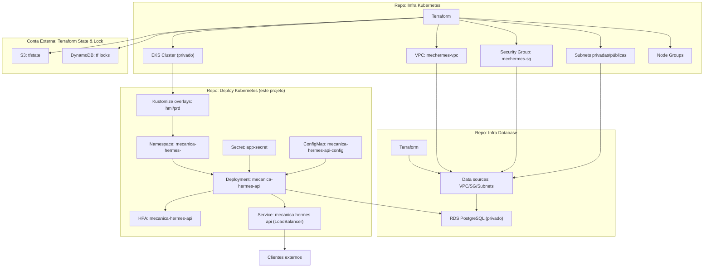

# Mecânica Hermes - Deploy Kubernetes

Este repositório é responsável por realizar o deploy do projeto.

---

## Tecnologias Utilizadas

---


- **Kubernetes** para orquestração das aplicações e recursos de cluster.
- **Kustomize** para sobreposição de ambientes (hml/prd) e padronização de manifests.
- **AWS** como provedor de nuvem.
- **Amazon EKS** como cluster Kubernetes gerenciado.
- **Amazon RDS (PostgreSQL)** como banco de dados consumido pela API.
- **kubectl** para aplicação e gerenciamento dos manifests.
- **Helm** para instalação de charts como New Relic.
- **New Relic** para observabilidade, monitoramento e APM.
- **GitHub Actions** para execução da pipeline de deploy/destroy.
- **Docker** para distribuição das imagens das aplicações.

---

## Arquitetura dos Projetos de Infra

Nossa infraestrutura para disponibilizar um ambiente completo e funcional é composta por três passos sequenciais que são executados em diferentes repositórios:

1. [Mecânica Hermes - Infra Kubernetes](https://github.com/fiap-challenge-13soat/mecanica-hermes-infra)
2. [Mecânica Hermes - Infra Database](https://github.com/fiap-challenge-13soat/mecanica-hermes-db)
3. Mecânica Hermes - Deploy Kubernetes (Este projeto)

---



## Execução pela Pipeline

**Configure as Secrets abaixo no repositório.**

---

| Variável              | Descrição                                                      |
| --------------------- | -------------------------------------------------------------- |
| AWS_ACCESS_KEY_ID     | Chave de acesso da AWS                                         |
| AWS_SECRET_ACCESS_KEY | Chave secreta da AWS                                           |
| AWS_SESSION_TOKEN     | Token de sessão da AWS                                         |
| AWS_DEFAULT_REGION    | Região padrão da AWS                                           |
| JWT_KEY               | Chave secreta para geração de tokens JWT                       |
| EMAIL_PASSWORD        | Senha para envio de emails                                     |
| MEDIATR_LICENSE_KEY   | Chave de licença do MediatR (opcional)                         |
| AUTOMAPPER_LICENSE_KEY| Chave de licença do AutoMapper (opcional)                      |
| NEW_RELIC_LICENSE_KEY | Chave de licença do New Relic para APM e monitoramento         |

---

Para gerar nova Key e Token use o comando:

```bash
aws sts get-session-token
```

---

### Deploy Environment

---
Dispare a Action Trigger manual para realizar o deploy do ambiente:

- `Kubernetes Deploy`.

---

### Destroy Environment

---
Dispare a Action Trigger manual para realizar o deploy do ambiente:

- `Kubernetes Destroy`.

---

> **Atenção!**
>
> Caso não tenha sido realizado o deploy do ambiente de infraestrutura de clusters e do database, será impossível concluir este deploy.
---

## Execução Local

Abordaremos os passos para realizar o deploy do ambiente em infraestrutura AWS partindo do seu computador.

---

### Configuração da AWS

Realize o comando abaixo e forneça suas credenciais.

```bash
aws configure
```

---

### Configuração do Kubectl

Configure o seu AWS com o Kubectl.

```bash
aws eks update-kubeconfig --name mechermes-eks
```

---

### Instalação do Helm

Instale o Helm (gerenciador de pacotes Kubernetes).

**Windows (via Chocolatey):**

```powershell
choco install kubernetes-helm
```

**Linux/MacOS:**

```bash
curl https://raw.githubusercontent.com/helm/helm/main/scripts/get-helm-3 | bash
```

Verifique a instalação:

```bash
helm version
```

### Criação do Namespace

Define ambiente de Homologação ou Produção

```bash
$ENVIRONMENT="prd" ou "hml"
```

```bash
kubectl apply -f k8s/overlays/$ENVIRONMENT/namespace.yaml
```

---

### Instalação do New Relic

Adicione o repositório Helm do New Relic:

```bash
helm repo add newrelic https://helm-charts.newrelic.com
helm repo update
```

Limpe recursos conflitantes (se existirem):

```bash
kubectl delete mutatingwebhookconfiguration newrelic-bundle-nri-metadata-injection --ignore-not-found=true
kubectl delete deployment newrelic-bundle-nri-kube-events -n newrelic --ignore-not-found=true
```

Defina a chave de licença do New Relic:

```bash
$NEW_RELIC_LICENSE_KEY="YOUR_NEW_RELIC_LICENSE_KEY"
```

Instale o New Relic nri-bundle:

```bash
helm upgrade --install newrelic-bundle newrelic/nri-bundle `
  --namespace newrelic `
  --create-namespace `
  --values k8s/base/newrelic/helm-values.yaml `
  --set global.licenseKey=$NEW_RELIC_LICENSE_KEY
```

Crie o secret do New Relic no namespace da aplicação:

```bash
kubectl create secret generic newrelic-license-secret `
  --from-literal=license-key=$NEW_RELIC_LICENSE_KEY `
  --from-literal=otlp-header="api-key=$NEW_RELIC_LICENSE_KEY" `
  --namespace mecanica-hermes-$ENVIRONMENT `
  --dry-run=client -o yaml | kubectl apply -f -
```

---

### Criação da Secret

Extraia o endpoint do database

```bash
$DB_ENDPOINT=aws rds describe-db-instances --db-instance-identifier mechermes-$ENVIRONMENT-rds --query "DBInstances[0].Endpoint.Address" --output text
```

Extraia o ARN do database

```bash
$DB_ARN=aws rds describe-db-instances --db-instance-identifier mechermes-rds --query "DBInstances[0].MasterUserSecret.SecretArn" --output text
```

Extraia a senha do database

```bash
$DB_PASSWORD=aws secretsmanager get-secret-value --secret-id $DB_ARN --query SecretString --output text | ConvertFrom-Json | Select-Object -ExpandProperty password
```

Defina as variáveis de ambiente necessárias:

```bash
$JWT_KEY="YOUR_JWT_SECRET_KEY"
$EMAIL_PASSWORD="YOUR_EMAIL_PASSWORD"
$MEDIATR_LICENSE_KEY="YOUR_MEDIATR_LICENSE_KEY"  # Opcional
$AUTOMAPPER_LICENSE_KEY="YOUR_AUTOMAPPER_LICENSE_KEY"  # Opcional
```

Crie o secret da aplicação:

```bash
kubectl create secret generic app-secret `
  --from-literal=ConnectionStrings__DefaultConnection="Host=$DB_ENDPOINT;Database=mechermesdb;Username=postgres;Password=$DB_PASSWORD;Pooling=true" `
  --from-literal=Jwt__Key=$JWT_KEY `
  --from-literal=EmailSender__Password=$EMAIL_PASSWORD `
  --from-literal=MediatR__LicenseKey=$MEDIATR_LICENSE_KEY `
  --from-literal=AutoMapper__LicenseKey=$AUTOMAPPER_LICENSE_KEY `
  --from-literal=NEW_RELIC_LICENSE_KEY=$NEW_RELIC_LICENSE_KEY `
  -n mecanica-hermes-$ENVIRONMENT `
  --dry-run=client -o yaml | kubectl apply -f -
```

---

### Configuração da Tag da Imagem (Opcional)

Por padrão, o Kustomize usará a tag `main`. Para usar uma tag específica:

```bash
cd k8s/overlays/$ENVIRONMENT
kustomize edit set image mechermes/mecanica-hermes-api=mechermes/mecanica-hermes-api:YOUR_TAG
cd ../../..
```

---

### Deploy das Aplicações

Deploy no ambiente selecionado:

```bash
kubectl apply -k k8s/overlays/$ENVIRONMENT
```

Aguarde os pods iniciarem:

```bash
kubectl get pods -n mecanica-hermes-$ENVIRONMENT -w
```

---

### Extração do Endpoint da API

```bash
kubectl get svc -n mecanica-hermes-$ENVIRONMENT
```

---

### Observações

> O processo de deploy pode demorar de 5 a 10 minutos.

---

### Correção de Problemas

> Este processo foi amplamente testado, mas caso ocorra algum erro durante a sua execução, sugerimos abrir o ambiente no VSCode e solicitar ajuda ao Co-Pilot.
