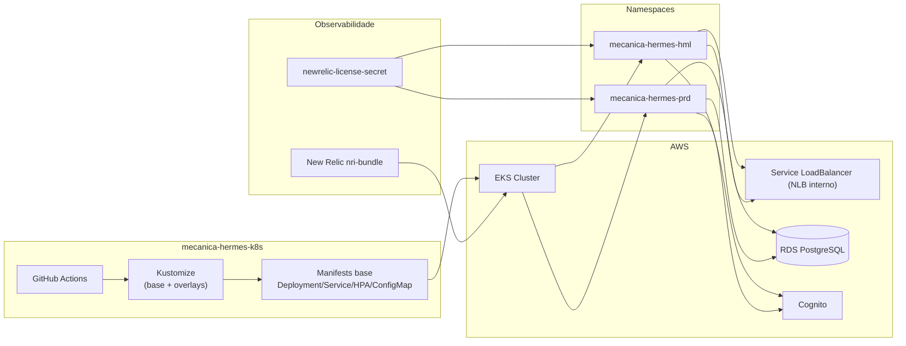

# Arquitetura de Deploy Kubernetes

Este documento descreve a arquitetura de deploy do repositório `mecanica-hermes-k8s`.

## Escopo do repositório

O repositório publica a aplicação no cluster EKS usando Kustomize com overlays por ambiente:

- `hml`
- `prd`

Também inclui workflows para deploy/destroy da API e para deploy/destroy de monitoramento New Relic.

## Visão arquitetural

## Componentes principais

- **ConfigMap**: parâmetros não sensíveis da API (`mecanica-hermes-api-config`).
- **Secret**: parâmetros sensíveis (`app-secret`) gerados no workflow com dados do RDS, JWT, SMTP e licenças.
- **Deployment**: aplicação `mechermes/mecanica-hermes-api:<tag>`.
- **Service**: `LoadBalancer` com NLB interno (necessário para integração via API Gateway VPC Link).
- **HPA**: escalonamento horizontal por CPU.

## Fluxo de deploy

1. Workflow `API - Deploy` recebe `environment` e `image_tag`.
2. Workflow configura `kubectl` no EKS.
3. Cria namespace e secret da aplicação.
4. Atualiza tag da imagem no overlay.
5. Executa `kubectl apply -k`.
